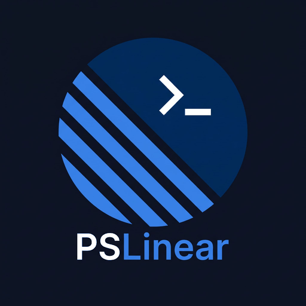

<p align="center">
  
</p>

# PSLinear

[](https://github.com/stian3555/PSLinear/actions/workflows/ci.yml)
[](https://www.powershellgallery.com/packages/PSLinear)
[](https://www.powershellgallery.com/packages/PSLinear)

A PowerShell module for [Linear](https://linear.app). Work with issues, projects, initiatives,
documents and more as real objects you can pipe, filter and format, from the terminal, in
scripts and in CI, and use any part of the Linear GraphQL API when there is no dedicated
cmdlet.

```powershell
Get-LinearIssue -Assignee me -StateType Unstarted, Started

Identifier   State            Priority    Assignee             Title
----------   -----            --------    --------             -----
ENG-412      In Progress      High        Ada Lovelace         Retry webhook deliveries on 5xx
ENG-398      Todo             Medium      Ada Lovelace         Document the deploy pipeline
```

> PSLinear is a community project and is not affiliated with or endorsed by Linear.

## Features

- **Covers most of Linear.** Issues with comments, attachments and relations; projects with
  milestones and status updates; initiatives; documents; teams, members and labels; cycles,
  templates, users and agent sessions. 61 cmdlets in all.
- **Pipeline-first.** Typed objects (`PSLinear.Issue`, `PSLinear.Project`, `PSLinear.Document`
  and more) with flattened properties for filtering and display, and the ids needed to chain
  commands.
- **Names instead of ids.** Give teams, states, labels, users, projects, initiatives and
  templates by name, key or `me`; issues, projects and documents also by URL. A state type
  such as `started` picks the right state in every team. Lookups are cached, and an unknown
  name fails with a list of the valid values.
- **Safe changes.** Every command that changes something supports `-WhatIf`, which sends
  nothing at all, and `-Confirm`. Removals ask first and use Linear's trash where it has one.
- **Fits your git workflow.** `Start-LinearIssue` assigns an issue to you, moves it to In
  Progress and checks out its branch; `Get-LinearIssue -Current` finds the issue of the branch
  you are on.
- **Sign in your way.** In the browser (OAuth with PKCE, renewed automatically), as an OAuth
  application with client credentials for unattended automation, with a personal API key, from
  a SecretManagement vault, or from an environment variable in CI. Tokens stay in memory as
  `SecureString`.
- **Automatic paging.** Results stream page by page. `-First` sets a limit; `-All` follows
  pagination to the end. Stopping early (`| Select-Object -First 5`) stops the requests too.
- **Handles the API's rules for you.** Retries rate-limited requests, server errors and
  network failures with backoff, but never sends a change twice; reports GraphQL errors even
  when they arrive with HTTP 200; and keeps queries well below Linear's complexity limit.
- **Escape hatch.** `Invoke-LinearGraphQL` runs any query or mutation, with `-WhatIf` for
  mutations.
- **Cross-platform.** PowerShell 7.4+ on Windows, macOS and Linux, tested on all three.

## Installation

```powershell
Install-PSResource -Name PSLinear
# or, with PowerShellGet 2.x:
Install-Module -Name PSLinear -Scope CurrentUser
```

Preview versions are published as prereleases: add `-Prerelease` (`-AllowPrerelease` for
`Install-Module`) to get the latest one.

## Quick start

```powershell
Connect-Linear -Browser     # sign in on Linear's consent page in your browser
Get-LinearViewer            # who am I?
Get-LinearTeam              # which teams can I see?
Get-LinearIssue -Assignee me
Start-LinearIssue ENG-123   # take an issue and check out its branch
```

Prefer an API key? Create one in Linear under **Settings > Security & access** and run
`Connect-Linear`, which prompts for it without echoing.

## Authentication

| Method | Command |
| --- | --- |
| Sign in through the browser (OAuth) | `Connect-Linear -Browser [-SecretName LinearSignIn]` |
| OAuth application (client credentials) | `Connect-Linear -ClientCredential $credential [-Scope read, write]` |
| Personal API key (prompt) | `Connect-Linear` |
| Personal API key (value) | `Connect-Linear -ApiKey $secureString` |
| SecretManagement vault | `Connect-Linear -SecretName LinearApiKey [-Vault MyVault]` |
| Environment variable | `Connect-Linear -FromEnvironment`, or just set `LINEAR_API_KEY` |
| OAuth access token | `Connect-Linear -AccessToken $secureString` |

When `LINEAR_API_KEY` is set, every command connects implicitly, so pipelines need no
`Connect-Linear` call. Storing the key in a vault keeps it out of your scripts and history:

```powershell
Install-PSResource Microsoft.PowerShell.SecretManagement, Microsoft.PowerShell.SecretStore
Set-Secret -Name LinearApiKey -Secret (Read-Host -AsSecureString 'Linear API key')
Connect-Linear -SecretName LinearApiKey
```

### Signing in through the browser

`Connect-Linear -Browser` opens Linear's consent page and receives the result on a local
address, like the official Linear integrations do. It uses OAuth 2.0 with PKCE, so there is no
client secret to keep. You approve **PSL**, the project's public OAuth application, and the
tokens go straight to your PowerShell session; the project never sees them or your data.

```powershell
Connect-Linear -Browser -SecretName LinearSignIn
```

Access tokens last 24 hours and are renewed automatically. With `-SecretName`, the refresh
token is saved in your SecretManagement vault, so later sessions sign in without the browser.
`Disconnect-Linear -Revoke` revokes the tokens at Linear and removes the saved one. Use
`-Scope` to ask for other permissions (`read`, `write`, `issues:create`, `comments:create`,
`timeSchedule:write`, `admin`) and `-RedirectUri` to use another port.

To sign in through your own OAuth application instead, for example to control what the consent
page shows or to restrict sign-ins to your workspace:

1. In Linear, go to **Settings > API > OAuth applications** and create an application. Its
   name cannot contain the word "Linear".
2. Add these callback URLs:
   `http://localhost:47821/callback` and `http://127.0.0.1:47821/callback`.
3. Connect with its client id, or set `LINEAR_OAUTH_CLIENT_ID`:
   `Connect-Linear -Browser -ClientId 'your-client-id'`.

### Signing in as an application

For automation that runs without a person, such as a scheduled job or a function app, sign in
as an OAuth application with the client credentials grant. Linear then shows the application,
not the owner of a personal API key, as the creator of issues and comments, and the credential
does not stop working when someone leaves.

1. In Linear, go to **Settings > API > OAuth applications**, create an application and turn on
   **client credentials**. Note its client id and client secret.
2. Store the secret where your automation keeps secrets, for example in a key vault or a
   protected environment variable.
3. Connect with the id as the user name and the secret as the password:

```powershell
$secret = ConvertTo-SecureString -String $env:LINEAR_CLIENT_SECRET -AsPlainText -Force
Connect-Linear -ClientCredential ([pscredential]::new($env:LINEAR_CLIENT_ID, $secret)) -Scope read, write
```

The token lasts 30 days. PSLinear keeps the secret as a `SecureString` and requests a new token
before the old one expires, and once more when Linear rejects it, so a long-running host only
needs to connect once, when it starts. Nothing is written to disk. Linear revokes all of the
application's tokens when one is requested with different scopes, so use the same `-Scope`
everywhere the application signs in.

## Examples

### Find issues

```powershell
# My open work, oldest update first
Get-LinearIssue -Assignee me -StateType Unstarted, Started | Sort-Object UpdatedAt

# Urgent and high-priority issues in progress for a team (tab-complete -Team)
Get-LinearIssue -Team ENG -State 'In Progress' -Priority Urgent, High

# Every bug in a team, counted by state
Get-LinearIssue -Team ENG -Label Bug -All | Group-Object State -NoElement | Sort-Object Count -Descending

# Current cycle for several teams
Get-LinearTeam -Name ENG, OPS | Get-LinearIssue -CurrentCycle

# Unassigned issues that mention "login"
Get-LinearIssue -Unassigned -Search login

# Raw IssueFilter combined with regular parameters: overdue open issues
Get-LinearIssue -StateType Unstarted, Started -Filter @{ dueDate = @{ lt = (Get-Date -Format 'yyyy-MM-dd') } }

# Export to CSV
Get-LinearIssue -Team ENG -All |
    Select-Object Identifier, Title, State, Assignee, PriorityLabel, Labels, UpdatedAt |
    Export-Csv -Path eng-issues.csv -NoTypeInformation
```

### Create and change issues

```powershell
# States, labels, projects and users are given by name
New-LinearIssue -Team ENG -Title 'Login fails on Safari' -Label Bug -Priority High -Assignee me -State Todo

# A sub-issue, due in a week
New-LinearIssue -Team ENG -Title 'Write tests for the retry logic' -Parent ENG-412 -DueDate (Get-Date).AddDays(7)

# From a template, planned for the next cycle and a project milestone
New-LinearIssue -Team ENG -Title 'Payment fails on retry' -Template 'Bug report' -Cycle next -Project Checkout -Milestone Beta

# Triage: assign every unassigned bug and add a label, keeping the existing labels
Get-LinearIssue -Team ENG -Label Bug -Unassigned | Set-LinearIssue -Assignee 'grace@example.com' -AddLabel Triaged

# Move the unstarted issues of the current cycle to the next one
Get-LinearIssue -Team ENG -Cycle active -StateType Unstarted | Set-LinearIssue -Cycle next

# Close issues across teams whose done states have different names, previewing first
Get-LinearIssue -Label Duplicate -StateType Unstarted -All | Set-LinearIssue -State completed -WhatIf

# Remove the due date and take an issue out of its cycle
Set-LinearIssue ENG-412 -Clear DueDate, Cycle

# Move issues to the trash (asks per issue unless -Confirm:$false); -Archive archives instead
Get-LinearIssue -Team ENG -Label Spam -All | Remove-LinearIssue
```

### Comments, files and relations

```powershell
# Comment, reply and resolve
Add-LinearComment ENG-412 'Deployed to staging.'
Get-LinearComment ENG-412 | Select-Object -Last 1 | Add-LinearComment -Body 'Thanks, fixed.'
Get-LinearComment ENG-412 | Where-Object { -not $_.IsReply -and -not $_.Resolved } | Set-LinearComment -Resolved $true

# Upload files, link a pull request, and show a screenshot in a comment
Add-LinearAttachment ENG-412 ./logs/*.log -Comment 'Logs from the failed run.'
Add-LinearAttachment ENG-412 -Url https://github.com/acme/app/pull/42
Add-LinearComment ENG-412 'After the fix:' -Attachment ./after.png

# Change one metadata value on the attachments of a build system, keeping the others
Get-LinearAttachment ENG-412 | Where-Object Url -Like 'https://ci.example/*' | Set-LinearAttachment -AddMetadata @{ passed = $true }

# What blocks my open work, and mark a duplicate
Get-LinearIssue -Assignee me -StateType Unstarted, Started | Get-LinearIssueRelation -Type BlockedBy
Add-LinearIssueRelation ENG-412 DuplicateOf ENG-398
```

### Git workflow

```powershell
# Assign the issue to you, move it to In Progress and check out its branch
Start-LinearIssue ENG-412

# Later, in the same repository: which issue is this branch for?
Get-LinearIssue -Current | Format-List Identifier, Title, State, Url

# Start several issues at once, without touching git
Get-LinearIssue -Assignee me -Cycle active -StateType Unstarted | Start-LinearIssue -NoBranch
```

### Projects, milestones and initiatives

```powershell
# Create a project for two teams, then start it and post a status update
New-LinearProject 'Checkout v2' -Team ENG, OPS -Lead me -TargetDate 2027-03-31 -Label Customer
Set-LinearProject 'Checkout v2' -Status started -AddMember 'grace@example.com'
New-LinearProjectUpdate -Project 'Checkout v2' 'Design approved; build starts Monday.' -Health OnTrack

# Plan a milestone and put issues in it
New-LinearMilestone -Project 'Checkout v2' -Name Beta -TargetDate 2027-02-01
Get-LinearIssue -Project 'Checkout v2' -Label Blocker | Set-LinearIssue -Milestone Beta

# Projects in progress whose latest update is not on track
Get-LinearProject -Status started | Get-LinearProjectUpdate -First 1 | Where-Object Health -NE 'OnTrack'

# Group projects in an initiative and post its status
New-LinearInitiative 'Q1 growth' -Owner me -Status Active -TargetDate 2027-03-31 |
    Set-LinearInitiative -AddProject 'Checkout v2', Website
New-LinearInitiativeUpdate -Initiative 'Q1 growth' 'Checkout v2 is on track; Website slipped a week.' -Health AtRisk
```

### Documents

```powershell
# Write a project document from a Markdown file, then read it back
New-LinearDocument 'Launch plan' -Project 'Checkout v2' -Content (Get-Content ./launch-plan.md -Raw)
Get-LinearDocument -Project 'Checkout v2' -Title 'Launch plan' | Get-LinearDocument | Select-Object -ExpandProperty Content

# Discuss it
Get-LinearDocument -Project 'Checkout v2' -Title 'Launch plan' | Add-LinearComment -Body 'Step 3 needs an owner.'
```

### Teams and labels

```powershell
# What can I use in a team? States, labels, projects and cycles
Get-LinearWorkflowState -Team ENG
Get-LinearLabel -Team ENG
Get-LinearProject -Team ENG -Status started | Sort-Object TargetDate
Get-LinearCycle -Team ENG -Previous -Active -Next

# Set up a sub-team with its own label group and members
New-LinearTeam 'Mobile' -Key MOB -Parent ENG
New-LinearLabel Platform -Team MOB -IsGroup
New-LinearLabel iOS -Team MOB -Group Platform -Color '#5E6AD2'
Add-LinearTeamMember MOB -User me, 'grace@example.com'
```

### Anything else

```powershell
# Raw GraphQL, with -WhatIf for mutations
Invoke-LinearGraphQL -Query '{ viewer { assignedIssues(first: 5) { nodes { identifier title } } } }'
Invoke-LinearGraphQL -Query 'mutation($id: String!) { issueUnarchive(id: $id) { success } }' -Variables @{ id = 'ENG-1' } -WhatIf
```

## Automation

PSLinear also runs unattended, for example in a job that keeps Linear issues in sync with
alerts, findings or tickets in another system. Sign in [as an application](#signing-in-as-an-application),
and let the job find its issues by the attachments it owns:

```powershell
$ErrorActionPreference = 'Stop'
$alertUrl = 'https://monitor.example/alerts/42'

# Look at every state, and at archived issues too, since Linear can archive closed issues automatically
$issue = Get-LinearIssue -Team OPS -AttachmentUrl $alertUrl -IncludeArchived -IncludeAttachment -All | Select-Object -First 1
if (-not $issue) {
    $issue = New-LinearIssue -Team OPS -Title 'Disk almost full on web-1' -State Todo
}

# Create the attachment that identifies the alert, or update it on later runs
Add-LinearAttachment $issue.Identifier -Url $alertUrl -Title 'Alert 42' -Subtitle 'Firing' -Metadata @{ alertId = 42; resolved = $false } -NoRichLink
```

To check many items at once, read every issue of the job with
`-AttachmentUrl 'https://monitor.example/alerts/*' -IncludeAttachment -IncludeArchived -All` and
compare the attachments' URLs and metadata in memory, instead of searching item by item.

### Errors you can rely on

- An empty result means that Linear found nothing. A failure is always reported as an error,
  never as an empty or shortened list.
- Failures of the API itself stop the command (a terminating error). A missing item, such as an
  issue identifier that does not exist, writes a non-terminating error so a pipeline can go on.
- PowerShell runs the next statement after both kinds of error unless you say otherwise, so set
  `$ErrorActionPreference = 'Stop'` (or use `-ErrorAction Stop`) in automation. Then a list that
  fails on a later page throws before the variable is assigned, so the job never works with
  part of the list.
- A change is never sent twice. PSLinear retries a mutation only when it never reached Linear or
  when Linear refused it because of the rate limit. After a server error, or a connection that
  failed during the request, the change may or may not have been made, so the command stops
  with `PSLinear.MutationOutcomeUnknown`. Check the result, for example on the job's next run,
  before you try again.

Errors carry a stable id in `$_.FullyQualifiedErrorId`:

| Error id | Meaning |
| --- | --- |
| `PSLinear.NotConnected`, `PSLinear.AuthenticationFailed`, `PSLinear.OAuthFailed`, `PSLinear.TokenRefreshFailed` | No valid credential, or the sign-in failed. |
| `PSLinear.ConnectionFailed` | Linear could not be reached, also after the retries. Nothing was changed. |
| `PSLinear.RateLimited` | Still rate limited after the retries. Nothing was changed. |
| `PSLinear.MutationOutcomeUnknown` | A change was sent, but the connection failed or Linear answered with a server error. Linear may or may not have made it. |
| `PSLinear.GraphQLError`, `PSLinear.HttpError` | Linear answered with an error. |
| `PSLinear.<Item>NotFound`, such as `PSLinear.IssueNotFound` | An item that does not exist. Non-terminating for an item you ask for (such as an issue identifier); an unknown name in a parameter (such as `-State`) stops the command before anything is sent. |
| `PSLinear.<Item>CreateFailed`, `PSLinear.<Item>UpdateFailed` | Linear rejected a change, for example invalid input (non-terminating). |
| `PSLinear.InvalidArgument`, `PSLinear.InvalidFilter` | Invalid parameters, or a filter that cannot be built (for example an unknown team). Nothing was sent. |

## Commands

Run `Get-Help <command> -Full` for every parameter and more examples.

### Connection

| Command | Description |
| --- | --- |
| `Connect-Linear` | Connect with a browser sign-in (OAuth with PKCE), an OAuth application's client credentials, an API key, a vault secret, an environment variable or an OAuth token. |
| `Disconnect-Linear` | Forget the credential and cached data; `-Revoke` also revokes an OAuth sign-in. |
| `Get-LinearViewer` | The authenticated user and organization. |
| `Get-LinearRateLimit` | Rate-limit status from the latest response. |

### Issues

| Command | Description |
| --- | --- |
| `Get-LinearIssue` | Issues by identifier or URL, the issue of the current git branch (`-Current`), or filtered lists with paging, also by attachment URL and with the attachments included. |
| `New-LinearIssue` | Create an issue, with states, labels, projects, milestones, cycles, users and templates given by name. |
| `Set-LinearIssue` | Change issues: state, assignee, labels (replace, add or remove), priority and more, or clear values with `-Clear`. |
| `Start-LinearIssue` | Start an issue: assign it to you, move it to a started state and check out its git branch. |
| `Remove-LinearIssue` | Move issues to the trash, or archive them with `-Archive`. |

### Comments, attachments and relations

| Command | Description |
| --- | --- |
| `Get-LinearComment` | Comments on an issue, project, initiative or document, thread by thread. |
| `Add-LinearComment` | Comment on an issue, project, initiative or document, or reply to a comment. |
| `Set-LinearComment` | Edit a comment, or resolve or reopen its thread. |
| `Remove-LinearComment` | Delete comments. |
| `Get-LinearAttachment` | Attachments of issues: uploaded files, links and integration links. |
| `Add-LinearAttachment` | Upload files to an issue (private by default) or link a URL to it, with optional metadata; `-NoRichLink` creates or updates a link in one request. |
| `Set-LinearAttachment` | Change an attachment's title, subtitle or metadata (replace it, or add and remove values). |
| `Remove-LinearAttachment` | Remove attachments from issues. |
| `Get-LinearIssueRelation` | Relations of an issue, seen from it: Blocks, BlockedBy, Related, DuplicateOf, DuplicatedBy. |
| `Add-LinearIssueRelation` | Relate issues: blocks, blocked by, related or duplicate. |
| `Remove-LinearIssueRelation` | Remove relations, by id or between two issues. |

### Projects and milestones

| Command | Description |
| --- | --- |
| `Get-LinearProject` | Projects with status, health, lead, teams, labels, dates and progress, filterable by team and status; `-Id` for the full project. |
| `New-LinearProject` | Create a project, with teams, lead, members, status, labels and template given by name. |
| `Set-LinearProject` | Change projects: status, lead, dates, priority, teams, labels and members (replace, add or remove), or clear values. |
| `Remove-LinearProject` | Move projects to the trash; Linear archives their issues until the project is restored. |
| `Get-LinearProjectUpdate` | Status updates of a project, or of every project, newest first. |
| `New-LinearProjectUpdate` | Post a project status update with a health (OnTrack, AtRisk, OffTrack). |
| `Set-LinearProjectUpdate` | Edit a status update's text or health. |
| `Remove-LinearProjectUpdate` | Remove status updates. |
| `Get-LinearMilestone` | Milestones of a project, or of every project, with status, target date and progress. |
| `New-LinearMilestone` | Create a project milestone. |
| `Set-LinearMilestone` | Rename, reschedule, reorder or move milestones. |
| `Remove-LinearMilestone` | Delete milestones; their issues stay in the project. |

### Initiatives

| Command | Description |
| --- | --- |
| `Get-LinearInitiative` | Initiatives with status, health, owner, projects and labels; `-Id` for the full initiative. |
| `New-LinearInitiative` | Create an initiative, with owner, labels and (on plans with team initiatives) lead team given by name. |
| `Set-LinearInitiative` | Change initiatives (status, owner, dates, labels) and add or remove their projects. |
| `Remove-LinearInitiative` | Move initiatives to the trash, or archive them with `-Archive`. |
| `Get-LinearInitiativeUpdate` | Status updates of an initiative, or of every initiative, newest first. |
| `New-LinearInitiativeUpdate` | Post an initiative status update with a health. |
| `Set-LinearInitiativeUpdate` | Edit an initiative status update's text or health. |
| `Remove-LinearInitiativeUpdate` | Remove initiative status updates. |

### Documents

| Command | Description |
| --- | --- |
| `Get-LinearDocument` | Documents of an issue, project, initiative or team, or all of them, most recently updated first; `-Id` for the content. |
| `New-LinearDocument` | Create a document in an issue, project, initiative or team. |
| `Set-LinearDocument` | Rename a document, replace its content, change its owner or move it. |
| `Remove-LinearDocument` | Move documents to the trash. |

### Teams, users and labels

| Command | Description |
| --- | --- |
| `Get-LinearTeam` | Teams, filterable by key or name with wildcards. |
| `New-LinearTeam` | Create a team or sub-team. |
| `Set-LinearTeam` | Rename a team, change its key, description, time zone or parent. |
| `Remove-LinearTeam` | Delete teams (archived until Linear deletes them with their issues). |
| `Get-LinearTeamMember` | Members of teams, with team ownership. |
| `Add-LinearTeamMember` | Add users to a team. |
| `Remove-LinearTeamMember` | Remove users from a team. |
| `Get-LinearUser` | Users, filterable by name or email; `-IncludeDisabled` for deactivated users. |
| `Get-LinearWorkflowState` | Workflow states per team, in workflow order, filterable by name or type. |
| `Get-LinearLabel` | Labels in the workspace, or the labels a team can use; `-IncludeGroups` and `-IncludeRetired` for the rest. |
| `New-LinearLabel` | Create a workspace or team label, or a label group. |
| `Set-LinearLabel` | Rename, recolor, regroup, retire or restore labels. |
| `Remove-LinearLabel` | Delete labels (Linear removes them from their issues). |

### Cycles, templates and more

| Command | Description |
| --- | --- |
| `Get-LinearCycle` | Cycles per team, with `-Active`, `-Next`, `-Previous` and `-Number`. |
| `Get-LinearTemplate` | Issue, project and document templates, optionally those a team can use. |
| `Get-LinearAgentSession` | Agent sessions (AI agents working on issues), with status and summary; read-only. |
| `Invoke-LinearGraphQL` | Run any GraphQL query or mutation. |

## How it works with the Linear API

- **Endpoint and auth.** All calls go to `https://api.linear.app/graphql`. Personal API keys
  are sent in the `Authorization` header as-is; OAuth tokens use `Bearer`, and tokens from a
  browser sign-in or client credentials are renewed shortly before they expire (or once, when
  Linear rejects one).
- **Rate limits and retries.** Linear limits requests and query complexity per hour, per user.
  PSLinear retries rate-limited calls, server errors and network failures with exponential
  backoff (3 times by default, set with `Connect-Linear -MaxRetries`). Mutations are retried
  only when Linear refused them or they never reached it, so a change is never made twice.
  `Get-LinearRateLimit` shows the remaining budget.
- **Complexity.** Linear rejects any single query above 10,000 complexity points. Pages are
  capped at 100 items, and nested lists are kept small, so every query stays well below that.
- **Name lookups.** Team, workflow state, label, user, project, project status, project label,
  initiative and initiative label names are resolved to ids with cached queries (10 minutes;
  states and labels per team). `Connect-Linear` and `Disconnect-Linear` clear the caches, a
  command that creates or renames something forgets the affected cache, and a name that is not
  found triggers one refresh.
- **Errors.** GraphQL errors are turned into PowerShell errors with the Linear error code in
  the message. A missing item, or a change Linear rejects, writes a non-terminating error, so
  the rest of the pipeline continues. Server, network and authentication failures always stop
  the command. Unknown names and invalid parameter combinations stop the command before
  anything is sent. See [Errors you can rely on](#errors-you-can-rely-on).

## Development

```text
src/
  PSLinear.psd1 / .psm1     manifest and loader
  Public/                   one exported function per file
  Private/                  internal helpers
  GraphQL/                  operations (*.graphql) and Fragments/
tests/                      Pester 5 tests (network calls are mocked)
tools/validate-graphql.mjs  validates every operation against Linear's published schema
tools/make_logo.py          draws assets/ (the logo) from its geometry
build.ps1                   Analyze, Build, Test and Publish tasks
```

```powershell
./build.ps1 -Bootstrap      # run PSScriptAnalyzer, build, and run the tests
Import-Module ./output/PSLinear/PSLinear.psd1 -Force
```

GraphQL operations live in `.graphql` files rather than strings in PowerShell code. That keeps
them readable and lets CI validate them against Linear's published schema on every push and
weekly, so a deprecated or removed field is caught before users hit it:

```bash
npm ci --prefix tools
node tools/validate-graphql.mjs
```

See [CONTRIBUTING.md](CONTRIBUTING.md) for the conventions and how to propose a change.

### Releasing

1. On a branch, set `ModuleVersion` in `src/PSLinear.psd1`. For a preview, also set
   `Prerelease` (for example `preview2`); for a stable version, leave `Prerelease` out.
2. In `CHANGELOG.md`, move the `Unreleased` entries under the new version and date, and update
   the links at the bottom.
3. Open a pull request and squash-merge it once CI passes.
4. Create a GitHub release from `main` with the matching tag, for example `v0.2.0` or
   `v0.2.0-preview1`, and mark previews as pre-releases.
5. The `Publish` workflow checks that the tag matches the manifest, then builds, tests and
   publishes to the PowerShell Gallery.

Releases are immutable and `v*` tags cannot be moved or deleted, so check the version before you
publish. A mistake means a new version, not a re-tag.

## Roadmap

- Tab completion for `-State`, `-Label` and `-Assignee`
- Markdown help with platyPS and an online help URI

## Security

Please report vulnerabilities privately, as described in [SECURITY.md](SECURITY.md).

## License

[MIT](LICENSE)
